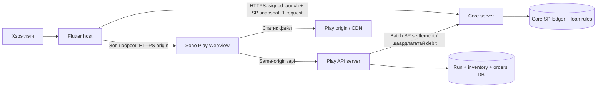
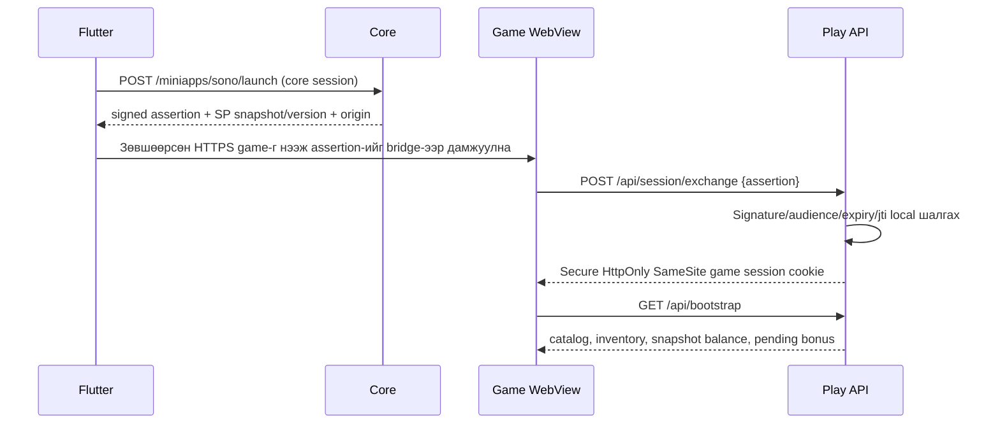
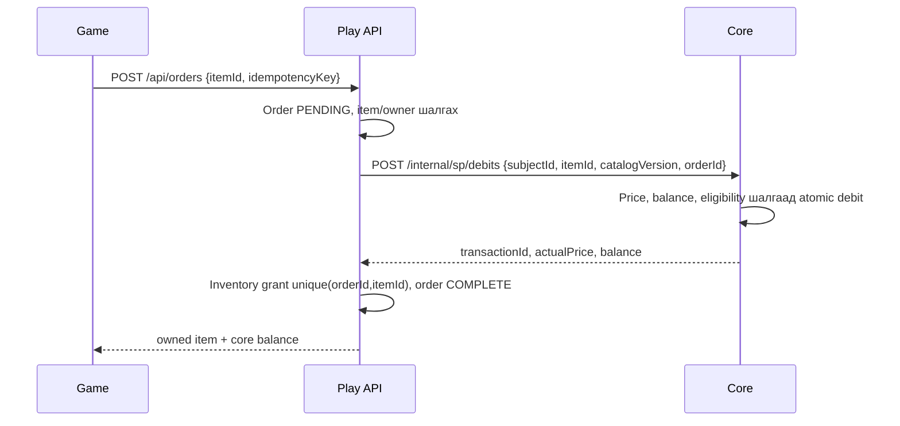

# Sono Play — хоёр серверийн production architecture

> Төлөв: санал болгож буй contract. Core-ийн бодит repository, API, SP бодлого хараахан ирээгүй. Эндэх endpoint нэр, TTL, reward тоо нь эцсийн хэрэгжүүлэлт биш. Шинэ шийдвэрээр frontend-ийг vendor байршуулна; шинэ [vendor уулзалтын баримт](docs/VENDOR_INTEGRATION_AGENDA.mn.md)-ыг энэ саналын deployment хэсгээс түрүүлж баримтална.

200,000 зэрэг тоглогчийн capacity, DB/CDN ачаалал, bonus оноогоор амь авах гүйлгээний дэлгэрэнгүйг [SCALE_200K_ARCHITECTURE.mn.md](SCALE_200K_ARCHITECTURE.mn.md)-ээс үзнэ.

## 1. Эзэмшил ба байршуулалт



Энд **хоёр бизнес сервер** байна: Core болон Play. CDN нь Play-ийн static файлын delivery давхарга; тусдаа бизнес эрх мэдэлгүй. `play.example.com/sono/v1/`-д game build, `play.example.com/api/`-д Play API байрлуулбал WebView cookie ба CORS энгийн болно. CDN `/api`-г cache хийхгүй, Play API руу route хийнэ. Core-ийн app token, SP ledger болон зээлийн мэдээлэл game JavaScript-д очихгүй.

| Байрлал | Хариуцах зүйл |
| --- | --- |
| Flutter host | Core login session, зөвшөөрсөн game URL/version, signed launch assertion хүсэлт, WebView navigation/bridge allowlist, back/full screen |
| Core server | Хэрэглэгчийн identity mapping, account/feature eligibility, SP policy, бодит SP balance ба immutable ledger, зээлийн эрхэд үзүүлэх нөлөө, audit |
| Play server | Launch assertion-ийн гарын үсгийг local шалгах, богино game session, run/challenge, gameplay validation/risk, pending bonus, cosmetic catalog/inventory, batch settlement/reconciliation |
| Play static build | Phaser UI, зураг/дуу, frame loop, practice/offline presentation; бодит SP тооцооны эрхгүй |

## 2. Core-ийн ачааллыг хамгийн бага байлгах шийдвэр

**Үндсэн сонголт:** Flutter core-д нэвтрэхэд **нэг л launch хүсэлт** илгээнэ. Core `subjectId`, account эрх, **SP balance snapshot + ledgerVersion**, policy/catalog version, `jti`, expiry, Play-ийн audience-тай, гарын үсэгтэй богино настай launch assertion буцаана. Play server core-ийн public key/JWKS-ийг cache-д хадгалж гарын үсэг, audience, хугацаа, `jti`-ийн нэг удаагийн хэрэглээг **өөрөө** шалгана. Ингэснээр Play-ээс core руу launch бүрт exchange эсвэл balance read хийхгүй. Assertion нь core access token биш, зөвхөн Play-д нэвтрэх bootstrap мэдээлэл. Энэ бол WeChat-ийн яг ижил protocol биш; core ачаалал багасгахын тулд сонгосон тусгай хувилбар.

Core launch дээр balance snapshot-ийг боломжтой бол өөрийн **материалжуулсан current balance**-аас уншина; хэрэглэгч нээх бүрт бүх ledger мөрийг нийлбэрлэж тооцохгүй. Signed assertion нь зөвхөн хэрэгтэй claim агуулна (`iss`, `aud`, `sub`, `iat`, `exp`, `jti`, balance/version, эрх); Play нь issuer, audience, зөвшөөрсөн signing algorithm, key ID-г тогтмол дүрмээр шалгана. [JWT BCP](https://www.rfc-editor.org/rfc/rfc8725.html)-ийн validation шаардлагыг мөрдөнө.

Play server тоглолт бүрийн score, run, anti-abuse, mission progress болон **pending bonus**-ыг өөрийн DB-д боловсруулна. Нэг run бүрт core руу хүсэлт явуулахгүй. Батлагдсан pending bonus-ыг хэрэглэгч/өдөр/rule-ээр нэгтгэж, Play worker core-ийн **bulk settlement API** руу багцаар илгээнэ. Core тус бүрийг өөрийн policy, eligibility, cap-аар шалгаж ledger-т атомикаар бичнэ. HTTP дуудлагын тоо багасна, харин core ledger-ийн шаардлагатай бичилт бүр үлдэнэ.

**Хоёр тоо тусдаа байна:** `pendingBonus` нь Play-ийн дотоод тооцоо; `availableSP` нь core ledger-т баталгаажсан үлдэгдэл. Flutter-ийн зээлтэй холбоотой дэлгэц зөвхөн core-ийн `availableSP`-г хэрэглэнэ. Game UI snapshot balance-ийг `asOf`/`ledgerVersion`-тай харуулж болох ч өөр газар SP өөрчлөгдвөл хуучирна. Core-д аль хэдийн event bus/outbox байвал `SpBalanceChanged(subjectId, balance, version)` болон account revoke event-ийг Play-д хүргэж cache-ийг шинэчилнэ. Ийм event суваг байхгүй бол balance нь snapshot гэдгийг UI-д тодорхой харуулж, бодит SP зарцуулахын өмнө core-т заавал шалгуулна.

| Үйлдэл | Core request-ийн тоо |
| --- | --- |
| Тоглоом нээх | Flutter → Core: 1; Play → Core: 0 (JWKS cache warm үед) |
| Frame/tap/pipe/run start/finish | 0; Play дотроо боловсруулна |
| Bonus SP | Run бүрт 0; worker олон хэрэглэгчийн settlement-ийг нэг bulk API call-д багцална |
| Play-ийн дотоод cosmetic coin зарцуулах | 0 |
| Бодит SP зарцуулах | Core-д тухайн debit-ийг нэг удаа commit хийх шаардлагатай |

## 3. Core-оос заавал авах мэдээлэл

| Өгөгдөл / capability | Хэзээ | Яагаад |
| --- | --- | --- |
| Signed launch assertion, public verification key | Нээхэд 1 удаа | Play core-г дахин дуудахгүйгээр login-г шалгах; `jti` нь Play-д нэг удаагийн хэрэглээтэй |
| Opaque, тогтвортой `subjectId` | Launch дээр | Play DB дахь хэрэглэгчийн run/inventory-г таних; утас, регистр, core access token хэрэггүй |
| Account status + `canPlay`, `canEarnSp`, `canSpendSp` | Launch snapshot; settlement/debit дээр core дахин шалгана | Түгжигдсэн, хориглогдсон, эрхгүй account-д бодит SP олгохгүй |
| Бодит SP `balance`, `ledgerVersion`, нэгж, `asOf` | Launch snapshot ба core гүйлгээний хариунд | UI-д эхний үлдэгдэл харуулах; Play DB-д authoritative balance үүсгэхгүй |
| Bulk reward settlement API | Play worker-ийн багц дээр | Core бодлого, cap, eligibility-г шалгаад хэрэглэгч бүрийн SP-г атомикаар нэмэх |
| Debit commit API | Худалдан авалтад | Core үнэ/каталогийн version, үлдэгдэл, account эрхийг атомикаар шалгаад суутгах |
| Transaction lookup by idempotency key | Timeout/retry/reconcile | Хариу алдагдлаа ч давхар нэмэх/суутгахаас сэргийлэх |
| Core service authentication + audit correlation | Settlement/debit дээр | Зөвхөн Play service-ийн зөвшөөрсөн эрхээр core API дуудах, мөрдөх |

**Core-оос авч магадгүй:** зөвшөөрсөн display name/avatar, locale, feature flags, campaign/mission eligibility, reward cap-ийн үлдэгдэл, account closure/revocation event. Эдгээрийг хэрэгцээтэй үед л авна. Зээлийн хэмжээ, гэрээ, хувийн мэдээллийг game service-д хуулбарлах хэрэггүй. Хэрэв тоглоомын SP зээлийн эрхэд шууд нөлөөлдөг бол `canEarnSp` болон policy нь core-ийн risk/loan rule-тэй уялдах ёстой; Play энэ дүрмийг өөрөө хэрэгжүүлэхгүй.

## 4. Session нээх урсгал



Assertion богино настай, Sono app/origin-д хязгаарлагдсан байна. Жишээ TTL 30–60 секунд; бодит хугацааг core тогтооно. Play нь `jti`-г атомикаар нэг удаа ашигласан гэж тэмдэглэнэ. Assertion-ийг URL query, localStorage, лог эсвэл analytics-д хийхгүй. Play session cookie JavaScript-д уншигдахгүй; unsafe request-д Origin/CSRF шалгалт хийнэ. Flutter зөвхөн зөвшөөрсөн origin/version-г нээж, navigation болон bridge method-ийг allowlist хийнэ. Core access token-ийг WebView-д дамжуулахгүй. Session дуусах/гарах үед Play session хүчингүй болно. JWKS cache байхгүй, key rotation алдаа гарвал Play нэвтрэлтийг түр зогсооно; баталгаагүй assertion хүлээж авахгүй.

## 5. Тоглолт ба bonus SP

```mermaid
sequenceDiagram
    participant W as Game
    participant P as Play API
    participant C as Core
    W->>P: POST /api/runs/start
    P-->>W: runId, challenge/seed, policyVersion
    Note over W: Frame loop локал, сервер дуудахгүй
    W->>P: POST /api/runs/{id}/finish {events, score}
    P->>P: Run, replay, cap/risk шалгаж pending bonus үүсгэх
    P-->>W: pending bonus; core SP одоогоор өөрчлөгдөөгүй
    Note over P: Олон run, хэрэглэгчийг batch болгоно
    P->>C: POST /internal/sp/reward-settlements/bulk
    C->>C: Account + policy + daily cap шалгаад ledger-т бичих
    C-->>P: Мөр бүрийн transactionId/decision/balance/version
    P->>P: pending -> settled/rejected; retry/reconcile
    W->>P: GET /api/bootstrap эсвэл /api/rewards
    P-->>W: Баталгаажсан SP + pending bonus тус тусад нь
```

**Санал болгох эхний reward policy:** хоолой бүрт бодит SP олгохгүй. Эхлээд өдөрт хязгаартай, server-side нөхцөл хангасан participation/mission reward; тодорхой `ruleId`, `policyVersion`, `dailyCap`, cooldown-той. Flappy төрлийн client physics болон pipe count-ийг хуурамчаар илгээж болдог. Seed/event шалгалт нь зөрчил илрүүлнэ, гэхдээ бүрэн баталгаа биш. Бодит SP-г score-той шууд пропорционал болгох шаардлагатай бол authoritative simulation эсвэл илүү хүчтэй сервер талын verification, fraud budget хэрэгтэй. Энэ шийдвэрийг core/risk баг батална.

Play API нь run бүрийн raw pipe count-оор SP нэмэх хүсэлт явуулахгүй. Play DB-д `subjectId + settlementPeriod + ruleId + policyVersion`-ээр нэгтгэсэн pending reward хадгална. Bulk хүсэлтэд approved rule ба evidence summary, тогтвортой `idempotencyKey` орно; **эцсийн SP дүн, cap-ыг core тооцож/шалгана**. Core батлагдсан мөр бүрт unique ledger key үүсгэнэ. Алдаатай мөр бусдыгаа блоклохгүй, мөр бүрийн outcome буцна. Play worker хэсэгчилсэн амжилт, timeout-ыг transaction lookup-аар reconcile хийнэ. Core унасан үед pending bonus үлдэнэ; available SP нэмэгдэхгүй. Core ledger өөрчлөгдсөн үед loan эрхийг **core-ийн өөрийн дүрэм/транзакц** шинэчилнэ.

Хэрэв product шийдвэрээр reward **шууд зээлийн эрхэд ашиглагдах SP** байх ёстой бол batch settlement-ийн хүлээлт тохирохгүй: тухайн reward-ийг core-д шууд commit хийж байж UI-д available SP болгон харуулна. Нэг удаагийн launch snapshot-оор энэ баталгааг орлуулж болохгүй. Core ачааллыг хамгийн бага байлгах сонголт нь Play-ийн дотоод game coins-ийг шууд олгоод, бодит SP-г зөвхөн хязгаартай mission settlement-аар өгөх юм.

## 6. SP-ээр cosmetic авах



Үнэ game bundle-д итгэж болохгүй. Core эсвэл core баталсан version-тэй catalog үнэ эзэмшинэ. Play inventory-д unique ownership, order state (`PENDING`, `DEBITED`, `COMPLETE`, `FAILED`, `REFUNDED`) хадгална. Debit амжилттай болоод Play унавал reconcile worker core transaction-ийг order/idempotency key-ээр шалгаад grant-ыг үргэлжлүүлнэ. Бүрмөсөн grant хийх боломжгүй бол core-д тухайн debit transaction-тай холбосон **идемпотент нөхөн кредит** хүснэ. “SP хүрэхгүй” болон “core холбогдохгүй” үед худалдан авалтыг баталгаажуулахгүй.

Core load хамгийн бага байх үндсэн сонголт: тоглоомын олон cosmetic item-ийг **Play-ийн дотоод coins**-оор авна. Энэ үед core debit огт хийхгүй. Хэрэв item-г заавал бодит SP-ээр авах бол launch үеийн balance snapshot-оор шийдвэр гаргахгүй; худалдан авалт бүрийн core debit зайлшгүй. Өндөр давтамжийн SP худалдаа бодитоор үүсвэл core-д эхлээд SP reserve/escrow хийж Play дээр зарцуулах тусгай wallet загварыг тусад нь үнэлж болно. Reserve хийх мөчид core available SP-г бууруулах, expiry/refund/reconcile хэрэгтэй тул одоохондоо санал болгож буй үндсэн хувилбар биш.

## 7. API contract-ийн санал

| Хүсэлт | Дууддаг тал | Үр дүнгийн гол талбар |
| --- | --- | --- |
| `POST core /miniapps/sono/launch` | Flutter | Signed assertion: `jti`, `subjectId`, `aud`, `exp`, `balance`, `ledgerVersion`, eligibility, `origin` |
| `GET core /.well-known/jwks.json` | Play worker, cache | Signature verification public keys; launch бүрт дуудахгүй |
| `POST core /internal/sp/reward-settlements/bulk` | Play worker | Мөр бүрийн `transactionId`, `awardedSp`, `balance`, `ledgerVersion`, decision |
| `POST core /internal/sp/debits` | Play API | `transactionId`, `debitedSp`, `balance`, `ledgerVersion` |
| `GET core /internal/sp/transactions/{key}` | Play worker | Commit outcome for recovery |
| `POST play /api/session/exchange` | Game | Assertion local verify, game session cookie |
| `GET play /api/bootstrap` | Game | Catalog, inventory, core balance snapshot/version, pending bonus |
| `POST play /api/runs/start`, `POST play /api/runs/{id}/finish` | Game | Run status, pending bonus; core request хийхгүй |
| `POST play /api/orders`, `GET play /api/orders/{id}` | Game | Purchase status, ownership, balance |

Эдгээр нь contract-ийн **санал**. Core-ийн бодит endpoint, auth, SP unit, error schema, transaction lifecycle-т тохируулна. Бүх mutation-д `requestId`/`traceId`, `idempotencyKey`, UTC timestamp, `policyVersion` хадгална. Core ↔ Play холболт private network болон service-to-service authentication (жишээ нь mTLS эсвэл private-key JWT) ашиглана; хэрэглэгчийн token-ийг Play backend-ийн machine credential болгон ашиглахгүй.

## 8. Найдвартай ажиллагаа ба performance

- Core SP ledger нь source of truth. Play-д launch snapshot ба event-ээр шинэчлэгдэх read model зөвхөн display-д байна; credit/debit шийдвэрийг cache-аар хийхгүй. Event хоцорсон/алдагдсан бол version gap илрүүлж resync хийнэ.
- Core transaction ба event publish-ийг transaction outbox-оор холбож, Play consumer-ийг idempotent болгоно. Core API timeout бол transaction lookup хийж байж retry/reconcile хийнэ.
- Core унасан үед game тоглож болно, Play server баталсан pending bonus хуримтлагдана, харин бодит SP reward settlement ба purchase `pending/unavailable`; буцааж ирэхэд сервер талын run/order-аас сэргээнэ. Offline local score-ийг дараа нь бодит SP болгон sync хийхгүй.
- Game frame loop network-ээс үл хамаарна. Session bootstrap нэг удаа; start/finish, store purchase дээр зөвхөн Play API дуудна. Version-тэй asset cache, menu-first load, sprite pooling, background pause хэрэглэнэ.
- Хэмжих үзүүлэлт: game-ready time, FPS/frame time, WebView memory, asset transfer, run finish latency, reward pending хугацаа, duplicate debit/reward = 0, reconciliation backlog.

## 9. Хэрэгжүүлэх дараалал ба Core багтай тохирох зүйл

1. Core баг `subjectId`, signed launch assertion, JWKS/key rotation, balance snapshot/version, bulk settlement, service auth, SP debit/lookup contract, алдааны кодыг батална.
2. Product/risk баг reward rule, daily cap, abuse response, SP-ийн зээлийн эрхэд үзүүлэх нөлөө, price ownership-ийг батална.
3. Play DB/API дээр session, run, pending bonus, batch worker, catalog/inventory, order, reconcile worker хэрэгжүүлнэ; game-д pending bonus ба core available SP-г тусад нь харуулна.
4. Flutter host-д signed launch assertion ба origin-bound bridge нэмж, stage орчинд Core ↔ Play integration болон timeout/replay/idempotency туршина.
5. SP-г эхлээд internal/staging хэрэглэгчид feature flag-аар нээж, ledger reconciliation болон fraud metric хэвийн бол production rollout хийнэ.

## Эх сурвалж

- [Tencent mini program login — one-time code, backend exchange](https://intl.cloud.tencent.com/document/product/1219/68263)
- [OAuth 2.0 Security Best Current Practice — authorization code, replay, sender constraint](https://www.rfc-editor.org/rfc/rfc9700.html)
- [JWT Best Current Practices — issuer, audience, algorithm validation](https://www.rfc-editor.org/rfc/rfc8725.html)
- [Android WebView native bridge security](https://developer.android.com/privacy-and-security/risks/insecure-webview-native-bridges)
- [AWS transactional outbox and idempotent consumer](https://docs.aws.amazon.com/prescriptive-guidance/latest/cloud-design-patterns/transactional-outbox.html)
- [Flutter profile-mode performance guidance](https://docs.flutter.dev/perf/ui-performance)
