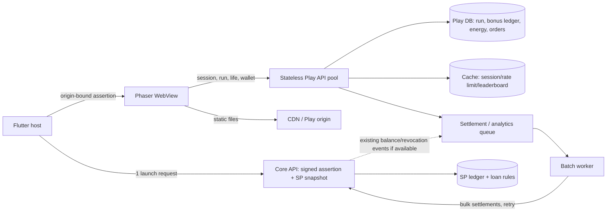

# Sono Play: 200,000 зэрэг тоглогчийн architecture ба амь/bonus economy

> Энэ бол production capacity **зорилтот загвар**, benchmark хийсэн баталгаа биш. `200,000 concurrent` гэдэг нь бүгд нэг секундэд нэвтрэнэ гэсэн үг биш. Core-ийн бодит API, SLO, дэд бүтцийн хэмжүүр байхгүй тул доорх хугацаа, хэмжээ нь ил тод таамаглал.

> Vendor frontend-ийг байршуулна; game API манай серверт байна. Same-origin proxy болон SEC-02 score evidence-ийн загвар нь [vendor уулзалтаар](docs/VENDOR_INTEGRATION_AGENDA.mn.md) шийдэх санал, батлагдсан contract биш. Доорх finish-only evidence нь score verification-ийн зөвшөөрөл биш.

## Шийдвэр

1. **Core** зөвхөн identity/эрх, бодит SP ledger, зээлтэй холбоотой дүрмийг эзэмшинэ. **Play** session, run, bonus credits, амь, cosmetics, leaderboard, risk, settlement queue-г эзэмшинэ.
2. Flutter game нээхэд core-ийн **нэг** хүсэлтээр богино настай signed launch assertion, SP snapshot/version авна. Play public key-ээр local шалгана; launch бүрт core exchange, balance read хийхгүй.
3. Run start/finish, амь хасах, game bonus олгох, bonus-оор амь авахад **core call = 0**. Эдгээр нь Play-ийн durable transaction.
4. **Play bonus credits** нь зөвхөн тоглоомын валют; core SP биш, зээлийн эрхэд ашиглагдахгүй. Бодит SP өгөх тусдаа mission reward-ийг Play `pendingSP` гэж бүртгээд core-т batch settlement хийнэ. Core ledger баталгаажсаны дараа л `availableSP` болно.
5. Бодит SP-ээр амь авахыг product заавал хүсвэл **нэг core debit-аар багц амь** худалдаж авч, цаашдын амь бүрийг Play дотроо зарцуулна. Snapshot баланс дээр тулгуурлан SP суутгахгүй.

## Холболтын зураг



CDN бол гурав дахь бизнес сервер биш. `play.example.com` дээр version-тэй static game, `/api` дээр Play API route байвал WebView same-origin session ашиглана. Gameplay-ийн frame/tap/pipe event core руу ч, Play API руу ч real-time явуулахгүй. Багц run evidence зөвхөн finish дээр очно. Session assertion-ийн issuer/audience/algorithm/expiry/нэг удаагийн `jti`-г Play шалгана; core token, loan data WebView-д очихгүй. JWT-ийн баталгаажуулалтад [RFC 8725](https://www.rfc-editor.org/rfc/rfc8725.html)-г баримтална.

## 200,000 хэрэглэгчийн capacity тооцоо

Энд **200,000 зэрэг идэвхтэй тоглогч**, нэг run дунджаар **60 секунд**, дахин эхлэх хооронд **15 секунд** гэж авлаа. Эдгээр нь хэмжсэн утга биш. `R = concurrent / (runSeconds + gapSeconds)`.

| Ачаалал | Тооцоо | Зорилтот peak |
| --- | --- | ---: |
| 200k хэрэглэгч 5 минутад нэвтрэх | `200,000 / 300` | ~667 launch/s Core ба Play |
| 200k хэрэглэгч 1 минутад нэвтрэх | `200,000 / 60` | ~3,333 launch/s Core ба Play |
| 200k хэрэглэгч 10 секундэд нэвтрэх | `200,000 / 10` | 20,000 launch/s; тусгай pre-scale/admission шаардлагатай |
| Тогтвортой run rate | `200,000 / 75` | ~2,667 starts/s + ~2,667 finishes/s Play |
| Start + finish API | `2 × 2,667` | ~5,334 Play requests/s; auth/bootstrap, wallet UI, retry нэмэгдэнэ |
| Амь худалдан авалт, хэрэглэгчдийн 1%/мин | `2,000 / 60` | ~33 Play orders/s |
| Амь худалдан авалт, 10%/мин stress | `20,000 / 60` | ~333 Play orders/s |

Хэрэв run 30 секунд, gap 10 секунд бол start+finish ~10,000 requests/s болно. Иймээс бодит run length distribution, retry rate, start/finish write amplification-ийг хэмжиж байж API/DB replica тоог сонгоно. **200k CCU өөрөө серверийн тоо хэлэхгүй.** Хэмжсэн нэг replica-ийн аюулгүй throughput `r`, peak `p`, нөөц коэффициент `h` бол API replica зорилт `ceil(p × h / r)`; `h`-г load test/SLO-оор тогтооно. DB connection pool-ийн нийлбэрийг DB capacity-гаас хэтрүүлж autoscale хийхгүй.

Энэ run rate-д start/finish нь тус бүр durable transaction бол **~5,334 DB transactions/s** суурь ачаалал. Transaction бүр 2–3 row/index mutation хийвэл order-of-magnitude **~10k–16k row mutations/s**, дээр нь session, wallet, analytics, WAL/replication нэмэгдэнэ. Нэг DB node энэ хэмжээг даана гэж урьдчилан үзэхгүй; load test-ийн үр дүнгээр partition, shard, storage/IOPS, connection pool-ийг тогтооно.

### Static asset ба сүлжээ

Одоогийн build `dist/` ~9.9 MiB; энэ нь **бүх asset**, нэг хүн эхлэхэд татах хэмжээ биш. JS ~336 KiB gzip; menu background ~412 KiB, logo ~672 KiB, pilot ~412 KiB, pipe ~664 KiB. Эдгээр болон font-ыг шинэ хэрэглэгч эхэндээ татвал **ойролцоогоор 2.5 MB cold load** болох магадлалтай; үүнийг browser network trace-ээр батална. 200k cold load-д ~500 GB CDN traffic; 1 минутад тарах бол ~8.3 GB/s буюу ~67 Gbit/s order-of-magnitude. Cache hit нь Play origin-ийн ачааллыг бууруулна, харин хэрэглэгчид хүргэх нийт байтыг арилгахгүй. CDN-ийн [request collapsing/cache key](https://docs.aws.amazon.com/eu_en/AmazonCloudFront/latest/DeveloperGuide/RequestAndResponseBehaviorS3Origin.html)-ийг ашиглаж, version-тэй immutable asset-уудыг урьдчилан warm хийнэ. `index.html` богино cache, JS/CSS hashed immutable; public asset-ууд version-тэй path-д байна.

Зорилт: анхны цэсэнд хэрэггүй store/alternate skin зургийг хойшлуулах, шаардлагагүй том PNG-ийг хэмжиж шахах, low-end төхөөрөмж дээр texture memory шалгах. **<1 MiB first playable transfer**-ийг туршилтын зорилт болгож, дизайн/чанарын шийдвэртэй хамт хэмжинэ; одоогийн build энэ зорилтыг хангаж байна гэж үзэхгүй. 200k утасны GPU ачаалал хэрэглэгчийн төхөөрөмж дээр, сервер дээр биш.

### Play API, хадгалалт

- Play API stateless, load balancer-ийн цаана horizontal scale; session/rate-limit/queue тусдаа. Оргил үеэс өмнө pre-scale, cold autoscaling-д найдахгүй.
- Run start-д **амь хасах + run үүсгэх** нэг durable DB transaction; finish-д **run-г нэг удаа close хийх + Play bonus ledger-д credit хийх** нэг transaction. Нэг хэрэглэгчийн wallet, energy, run-г нэг DB shard/transaction boundary-д байрлуулна; `userId`-аар хуваарилсан data/access, global counter-д run бүрээр бичихгүй.
- SQL `unique(userId, requestId)`, `unique(runId, rewardType)`, `unique(orderId)`-ээр replay хамгаална. DB isolation/conditional update-ээр хоёр төхөөрөмж зэрэг start хийхэд сүүлчийн амийг давхар хэрэглэхгүй. Cache/Redis нь rate limit, leaderboard, богино session acceleration-д; **bonus wallet ба амийн цорын ганц эх үүсвэр биш**.
- Run history-г хугацаагаар partition/архивлах, богино хадгалах raw evidence ба урт хадгалах economy ledger-ийг ялгах. Partition нь тусалдаг ч ганц DB 5k–10k writes/s даана гэж таамаглахгүй; [PostgreSQL partition guidance](https://www.postgresql.org/docs/current/ddl-partitioning.html) + load test-ийн үр дүнгээр shard/managed DB scale шийднэ.
- Leaderboard/analytics-ийг async queue руу шилжүүлнэ. Queue lag нь тоглоомыг гацаахгүй; wallet/energy mutation-ийг queue-д алдаж болзошгүй fire-and-forget болгохгүй.

### Core-г хамгаалах

- Core launch endpoint хөнгөн: materialized current SP balance/version read + signed assertion; бүх ledger-ийг дахин нийлбэрлэх, loan module-ийн олон join хийхгүй. Play JWKS/public key-ийг cache-д авна.
- Campaign эхлэхээс өмнө Core launch path-ийг 667/s, 3,333/s, богино burst 20,000/s нөхцөлд **тусад нь** benchmark хийнэ. Core-ийн бусад үйлчилгээнд зориулсан CPU/DB capacity-г тусгаарлах, rate limit/admission control тавих шаардлагатай.
- Core-ийн хэмжсэн safe limit-ээс давбал game menu/static файлыг CDN-ээс эхэлж харуулж, auth launch-ийг хязгаарлагдсан rate-аар queue-д оруулна. “Түр хүлээнэ үү” төлөв харуулна; client retry storm үүсгэхгүй. 200k хүн яг нэг агшинд дарвал тодорхой хүлээлт үүснэ — capacity хэмжихгүйгээр 0 latency амлахгүй.
- Core reward settlement worker batch size/parallelism-ийг core-ийн тусгай quota-д барина. Багц дотор мөр тус бүр idempotent, partial result-тэй. HTTP дуудлагыг багцлах нь DB ledger write-ийг үгүй болгохгүй. Loan entitlement-ийг core-ийн өөрийн transaction/rule шинэчилнэ.
- Core баланс Play дээр snapshot/read model байж болно. Core-д аль хэдийн outbox/event stream байвал balance/version ба account revoke event-ээр шинэчилнэ; event version gap гарвал resync. Cache-д тулгуурлан SP debit хийхгүй. [Transactional outbox](https://docs.aws.amazon.com/prescriptive-guidance/latest/cloud-design-patterns/transactional-outbox.html) нь core transaction ба event-ийг алдагдуулахгүй холбох нэг арга.

## Bonus оноо → нэмэлт амь/тоглох эрх

### Гурван өөр тоо

| Төрөл | Эзэмшигч | Хэрэглээ |
| --- | --- | --- |
| `playBonusCredits` | Play durable wallet/ledger | Нэмэлт амь, cosmetic, game-only perk; SP болон зээлийн эрх биш |
| `freeEnergy` + `extraLives` | Play energy account | Нэг run эхлэхэд нэг эрх зарцуулагдана |
| `availableSP` | Core ledger | Core-д баталгаажсан бодит SP; зээлийн эрхэд хамаарч болно |

`pendingSP` бол core settlement хүлээж буй **тусдаа төлөв**, available balance-д нэмэгдэхгүй. Play bonus credits-ийг нэг талаас амь авахад зарцуулж, нөгөө талаас SP болгон дахин тооцохгүй. Хэрэв нэг валют хоёуланд нь хэрэгтэй гэж шийдвэл Play bonus ledger-д conversion reserve/debit хийж, core settlement амжилттай болсон үед finalize хийх нэмэлт урсгал шаардлагатай; энэ нь core load болон алдааны нөхөн сэргээх төвөгийг өсгөнө. **Зөвлөмж: Play credits ба SP mission reward-ийг тусад нь байлгах.**

### Амь авах гүйлгээ

```mermaid
sequenceDiagram
    participant G as Game
    participant P as Play API
    participant D as Play durable DB
    G->>P: POST /api/lives/purchase {packId, requestId}
    P->>D: BEGIN; user wallet/energy lock буюу conditional update
    D->>D: requestId шалгах, server price, credits >= cost, cap шалгах
    D->>D: bonus ledger debit + extraLives grant + order COMPLETE
    D-->>P: COMMIT; walletVersion, credits, extraLives
    P-->>G: баталгаажсан шинэ төлөв
```

Нэг transaction-д bonus credits хасаж, extra lives нэмнэ. Үнэ client-ээс авахгүй; `packId`-аар Play server-ийн versioned catalog-оос авна. Давтан tap/retry ижил `requestId`-ийн үр дүнг буцаана. `extraLives`-ийг free energy-ээс тусад нь хадгалбал free regen-ийн cap-д үрэгдэхгүй. Нэг run эхлэхэд сервер lazy regeneration-ийг UTC цагаар тооцоод эхлээд freeEnergy, дууссан бол extraLives-ийг **run үүсгэхтэй нэг transaction-д** хасна. Нэг user-д зэрэг идэвхтэй run-ийн бодлого тогтооно (анхнаасаа 1 гэж санал болгож байна). Алдаа/тасралттай run timeout ба refund-ийн тодорхой policy хэрэгтэй.

**Хязгааргүй амь бий болгох loop-ийг хаах:** run-ээс олох bonus-ийн дээд хэмжээ, амийн pack үнэ, өдрийн earn/purchase cap-ыг хамт загварчилна. Нэг амь зарцуулсан run тогтмол тэр амийг өөрөө санхүүжүүлдэг бол automation хязгааргүй тоглоно. Жишээ policy дүрэм: `maxBonusPerRun < costOfOneExtraLife`, эсвэл capped mission reward. Яг тоог product/risk шийднэ. Bonus-г зөвхөн server-validated, нэг удаа finish хийсэн run-д олгоно; raw client score-ийг үнэн гэж үзэхгүй. Financial SP reward-ийг client-reported pipe count-оос тооцохгүй.

### Хэрэв амийг заавал бодит SP-ээр авна гэвэл

Game → Play order → **Core-ийн нэг атомик SP debit** → Play extraLives pack grant. Нэг амь бүрт core дуудахгүй байхыг хүсвэл 5/10 амийн pack зарна: нэг debit, дараагийн run-ууд Play дотроо. Debit амжилттай болоод Play grant алдагдвал order reconciliation нөхөж grant эсвэл core compensation хийнэ. Core offline үед SP purchase баталгаажихгүй; Play bonus credits-ээр авах сонголт үргэлжилж болно. Launch snapshot-аас шууд SP хасвал core-ийн бусад хэрэглээтэй race үүсдэг тул хэрэглэхгүй. Өндөр давтамжийн SP амийн худалдаанд escrow/prepaid wallet бодож болох ч core available SP-г **урьдчилан** бууруулж reserve, expiry/refund/reconcile хийх учир эхний хувилбарт хэрэггүй.

## Failure mode ба шалгах gate

| Нөхцөл | Хэрэглэгчид харагдах байдал | Серверийн ажиллагаа |
| --- | --- | --- |
| Core launch ачаалалтай | Game menu ажиллана, login queue/wait | Controlled admission, jittered retry; core-г retry storm-оос хамгаална |
| Play API түр унасан | Run эхлэх/амь авах боломжгүй | Durable wallet/energy-д хагас гүйлгээ үүсэхгүй; safe retry |
| Core settlement унасан | Play credits/амь ажиллана, SP `pending` | Worker retry + idempotency + dead-letter/reconcile |
| Core SP snapshot хуучирсан | `asOf`/refresh төлөв | Core debit л final; loan screen core balance хэрэглэнэ |
| Хоёр төхөөрөмж нэг амь зэрэг ашиглах | Нэг start зөвшөөрөгдөнө | DB conditional update/unique active run |
| Core debit амжилттай, Play grant унасан | Order `processing` | Transaction lookup, retry grant, шаардвал compensation |

**Release gate:** 200k CCU-д arrival pattern-ийг 5 мин/1 мин/10 секээр тусад нь ачаалж, CDN cold/hot cache, Play API/DB, Core launch, batch settlement-ийг тус бүр ба хамтад нь хэмжинэ. P95/P99 latency, DB CPU/IO/connections, queue lag, core бусад endpoint-ийн latency, error rate, duplicate wallet/SP transaction = 0, recovery time-ийг record хийнэ. Нэг cloud/provider, node count, DB shard count-г benchmark-гүйгээр “хангалттай” гэж зарлахгүй. [Google Cloud load-test guidance](https://docs.cloud.google.com/load-balancing/docs/backend-service-load-testing) throughput болон over-capacity behavior-ийг тусад нь хэмжихийг зөвлөдөг.

**Эхний SLO санал (батлах шаардлагатай):** Play `run/start` ба `run/finish` p95 <300 ms, p99 <1 s; амь худалдан авалт p95 <500 ms; тоглоомын API error <0.1% хэвийн peak-д; баталгаажсан SP settlement-ийн 95% <5 минут; давхар wallet/SP бичилт 0. Cold start нь сүлжээ, CDN, төхөөрөмжөөс хамаарах тул low-end бодит төхөөрөмж дээр тусад нь хэмжиж зорилт тогтооно. Core-ийн бусад endpoint-ийн p95/p99 launch surge-ийн үед мэдэгдэхүйц муудах ёсгүй; зөвшөөрөгдөх босгыг core баг тогтооно.

## Одоогийн хэрэгжүүлэлтийн зөрүү

Одоогийн Sono Play frontend `localStorage`-д practice coins хадгалж, pipe давмагц `+100` гэж өөрөө тооцдог; game server, energy account, bonus ledger, signed launch, core settlement **хараахан байхгүй**. Demo Pocketwise API нь production core биш. Эндхийн шийдвэрийг production-д хэрэгжүүлэхийн өмнө core contract, SP policy, bonus/life pack price/cap, run duration distribution, latency SLO, deployment region-ийг батлах хэрэгтэй. [Ерөнхий integration contract](PRODUCTION_ARCHITECTURE.mn.md)-тай хамт уншина.
