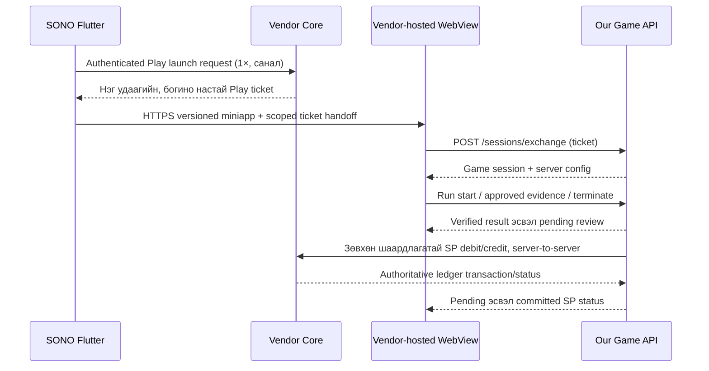

# SONO miniapp × vendor core × манай game server — уулзалтын баримт

**Төлөв:** 2026-11-16-ны санал. Vendor-ийн API, security ба санхүүгийн баг батлаагүй. Үйлдвэрлэлд холболт идэвхжүүлэх зөвшөөрөл биш.

## 1. Батлагдсан эзэмшил ба санал болгож буй зам

| Хэсэг | Эзэмшигч | Хариуцлага |
| --- | --- | --- |
| SONO Flutter апп + frontend hosting | Vendor | Core login, WebView, HTTPS static build, native Back/PIN, release |
| Game service + game DB | Манай тал | Богино game session, run, gameplay evidence/validation, verified result, skins, leaderboard, operational logs, pending rewards |
| Core + SP ledger | Vendor/core | Хэрэглэгчийн эрх, бодит SP balance/debit/credit, policy/cap, зээлийн эрхийн үр дагавар, санхүүгийн audit |

`displayScore` (дэлгэц), `verifiedPipeScore` (game server баталсан), `pendingSP` (санал/хүлээлт), `availableSP` (core ledger-д бүртгэгдсэн) гэсэн дөрвөн утгыг нэр ба UI-гаар ялгана. `game coin` байвал SP-ээс тусдаа валют. WebView, localStorage, Flutter bridge-ийн хүсэлт нь санхүүгийн шийдвэр биш.

**Origin-ийн санал:** vendor-ийн HTTPS origin дээр versioned static build байрлуулж `/api/game/*`-ийг манай game API руу proxy хийх. Тэгвэл WebView-ийн origin, cookie, CORS энгийн. Proxy боломжгүй бол vendor origin ↔ game API origin-ийн яг зөвшөөрсөн CORS, session/cookie эсвэл scoped token, CSP ба WebView navigation дүрмийг хамт батална. Энэ нь hosting ба route-ийн шийдвэр; game API-гийн өгөгдлийн эзэмшил манайд хэвээр.

## 2. Vendor-той батлах үндсэн 8 шийдвэр

1. **URL/release:** Production/stage domain, subpath, HTTPS cert, `/api/game` proxy, CSP, CDN cache policy, artifact signature/hash, rollback, Flutter allowlist, хамгийн бага iOS/Android/WebView хувилбар хэн хариуцах вэ? `index.html` болон API-г хуучин asset-тай зөрүүлэхгүй version pin хэрэгтэй.
2. **Login handoff:** Core одоогийн auth-аар `POST /miniapps/sono/launch` төстэй Play-д зориулсан нэг удаагийн ticket олгох уу? Ticket-д opaque user ID, issuer, audience, `jti`, expiry, entitlement, app/config version орж болох; яг format/TTL/key rotation-г vendor тогтооно. Core refresh/access token, PIN, loan detail JS-д огт очихгүй. URL query-д bearer/token тавихгүй.
3. **Ticket validation:** Манай game server core-ийн гарын үсгийг cached public key-ээр шалгах уу, эсвэл core exchange/introspection дуудах уу? Нэг удаагийн `jti`-г atomic хэрэглэж, хугацаа дууссан/давтагдсан ticket-г няцаана. Core ачаалал бага байлгах санал нь local signature validation, харин vendor боломжийг батлах ёстой.
4. **SEC-02 оноо:** `runId`, server seed/config/version, input evidence, clock, heartbeat/checkpoint, server replay/risk review-ийн аль загварыг backend баг батлах вэ? Browser-ийн “би 999 оноо авлаа” гэдэг мэдэгдэл, client hash эсвэл client timestamp дангаараа баталгаа биш. Тоглоомын автоматаар үүсэх хоолойн дарааллыг ч боломжтой болгох шаардлагатай.
5. **SP гэрээ:** Core balance snapshot өгөх үү, ledger version/expiry юу вэ? Purchase бүрт core debit, reward бүрт core policy/ledger commit хэрэгтэй юу? Дүнгийн нэгж, rounding, daily/user caps, loan эрхэд үзүүлэх нөлөө, transaction lookup, refund/compensation, idempotency, audit event-ийн owner-ийг батална. Snapshot-оор SP зарцуулж болохгүй.
6. **Амь/эрх:** Free attempt/day, run эхлэхэд эрх хэзээ reserve/consume хийх, app background/offline/серверийн алдаанд буцаах эсэх, SP-ээр авсан bundle-ийн хугацаа ба refund. Mid-run revive байхгүй гэсэн өмнөх тоглолтын дүрмийг худалдан авалттай нийцүүлнэ.
7. **Өгөгдөл ба operation:** Opaque ID mapping, log-д PII хязгаар, retention, access/audit, data residency, on-call owner, alert/SLO, stage sandbox, rate limit, outage үед UX ба reconciliation owner.
8. **Бүтээгдэхүүний version:** 3 theme × 4 time state, солигдох pipe cadence, 3–4 skin ба verified single-run threshold, leaderboard score unit (pipe эсвэл meter), SP reward rule-ийг versioned server config-д хэн батлах вэ? Одоогийн demo-ийн 25/50/100/200 нь release дүрэм биш.

## 3. Санал болгох API багцууд (нэрс нь жишээ)

| Чиглэл | API | Нэн чухал contract |
| --- | --- | --- |
| Flutter → Core | `POST /miniapps/sono/launch` | Play-only, short-lived, one-time ticket; eligibility; no core token in JS |
| Game → Core | `GET /jwks` эсвэл introspection | Signature/key rotation; issuer/audience validation; availability/caching |
| WebView → Game | `POST /sessions/exchange`, `GET /bootstrap` | Ticket нэг удаа ашиглах; scoped session; versioned config |
| WebView → Game | `POST /runs`, evidence, `POST /runs/{id}/terminate`, `GET /runs/{id}/result` | One active run/account, sequence, server verification, pending/rejected/verified result |
| WebView → Game | `GET /leaderboard`, `GET /inventory` | Зөвхөн verified scores ба owned items |
| Game → Core | `POST /sp/debits`, `POST /sp/rewards`, `GET /transactions/{key}` | Server auth, stable idempotency key, core policy/ledger outcome, status lookup |

Бодит SP-ээр амь авах UX-д core-ийн native PIN/biometric confirmation хэрэгтэй бол Flutter/Core эзэмшинэ; WebView PIN оруулахгүй. Debit амжилттай боловч game inventory grant тасарвал game server durable order status-аас reconcile хийнэ эсвэл core-т idempotent compensation хүснэ. Reward нь core commit хүртэл `pending`; зээлийн эрхийг зөвхөн core өөрөө өөрчилнө. Core ledger ба game DB-ийг нэг transaction гэж үзэхгүй.

## 4. Үл ойлголцол, алдааны гол цэг

| Төөрөгдөл/алдаа | Тохирох шийдэл |
| --- | --- |
| “Оноо” гэдэг үг game score, bonus coin, real SP-д холилдох | Тус бүрийн schema field, UI status, ledger owner-ийг тусад нь нэрлэх |
| Flutter login token-ийг WebView-д шууд дамжуулах | Зөвхөн Play-д зориулсан богино ticket; one-time exchange; native secret JS-д байхгүй |
| Game client score-г шууд core руу өгөх | Core зөвхөн манай game server-ийн verified result/settlement хүсэлтийг server auth-аар авна; SEC-02-г тусад нь батлах |
| Launch үеийн SP balance-ийг дараа нь purchase-д ашиглах | Balance snapshot зөвхөн display; debit core-д real-time, idempotent |
| Timeout болоход retry хийж давхар SP суутгах/олгох | Stable idempotency key + transaction lookup + reconciliation; unique ledger key |
| Core debit commit, game grant fail | Durable order state, retry, шаардлагатай үед compensation/refund |
| WebView хаагдах, app background, offline | Terminal run, server timeout, verified/pending result; offline client score дараа нь SP болж sync хийхгүй |
| Frontend хуучин, game config шинэ | Versioned build/config/physics/seed/asset manifest; staged rollout + rollback |
| Хоёр төхөөрөмж зэрэг тоглох | Game server дээр user бүрт ганц active run-г atomic enforce хийх |
| Vendor static site-ээс манай API-д cross-origin call тасрах | Same-origin proxy эсвэл exact CORS/session contract; staging iOS/Android WebView QA |

## 5. Core ачаалал ба release шалгуур

Core-д tap/frame/pipe бүрээр хүсэлт явуулахгүй. Launch ticket нэг удаа, бодит SP purchase/reward дээр шаардлагатай mutation, account revoke/balance update бол event эсвэл controlled refresh. Гэхдээ 200,000 зэрэг тоглогчтой үед одоогийн demo-ийн 5 секунд тутмын frontend `HEAD` probe дангаараа ~40,000 request/s үүсгэнэ: production-д game-service heartbeat/timeout-ийн хэмжсэн contract-оор солих ёстой. 200,000 concurrency бол benchmark баталгаа биш; launch burst, run start/finish, DB writes, queue backlog, CDN/WebView cold start-ыг тус тусад нь load test хийнэ.

Stage acceptance: fake score 9999, ticket replay/expiry, хоёр төхөөрөмж, duplicate debit/reward, debit commit + grant fail, delayed result, app background, offline, core/game API outage, old frontend version, iOS/Android WebView navigation/CSP, load spike — бүгд хүлээгдсэн төлөв/ledger invariant-тай байх. Vendor ба манай баг OpenAPI/JSON schema, auth sample, error codes, retry/idempotency matrix, test users, stage URLs, monitoring contacts-аа харилцан өгөх нь уулзалтын бодит үр дүн.

## Эх сурвалж

- [OAuth browser application security BCP (RFC 10017)](https://www.rfc-editor.org/rfc/rfc10017.html)
- [JWT validation BCP (RFC 8725)](https://www.rfc-editor.org/rfc/rfc8725.html)
- [Android WebView native bridge security](https://developer.android.com/privacy-and-security/risks/insecure-webview-native-bridges)
- [Transactional outbox and idempotent consumers — AWS](https://docs.aws.amazon.com/prescriptive-guidance/latest/cloud-design-patterns/transactional-outbox.html)
- [OWASP Game Security Framework](https://owasp.org/projects/gamesec-framework)
